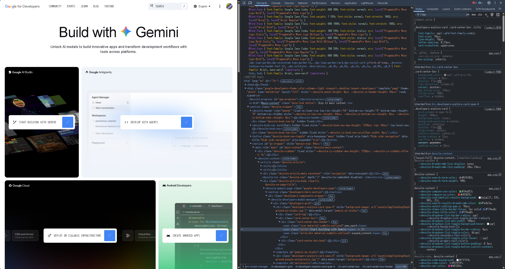

# Respect My Eyes

Use **your** fonts on every website. The extension replaces the fonts a site picked with the serif, sans-serif and monospace fonts from your browser's font settings, and leaves icons, code editors and layout alone.

Big thanks to the [Original Project](https://github.com/sysop84/force-my-browser-fonts). Licensed under the GNU GPL v3 (see [`LICENSE`](LICENSE)).

## Demo

`developers.google.com`: many shadow DOMs, variable fonts, dynamic loading.

[](preview.png)

## Why

- **One setting for the whole web.** Fonts come from `chrome://settings/fonts` and follow it live. Nothing to configure per site.
- **Works on hard sites.** Variable fonts, shadow DOM, CDN-hosted stylesheets, CSS variables, and fonts loaded or registered in JavaScript (`FontFace` / `document.fonts`, including SPA route and language switches) are all handled.
- **Icons stay icons.** Icon fonts (Font Awesome, Material Symbols, emoji...) are detected and never replaced.
- **Code editors keep their cursor.** Monaco, CodeMirror, Ace and xterm.js are recognised on their own, so the cursor and selection stay aligned with the text.
- **Fix a site in two clicks.** The toolbar popup lists fonts it could not classify; pick a category and press Add.
- **Practices what it preaches.** The popup and the settings page use your fonts too.
- **Easy to correct.** Every destructive action in settings has an Undo, and settings can be exported and imported.
- **Private.** No network requests, no analytics. Everything stays in your browser.

## Install

1. Open `chrome://extensions` and turn on **Developer mode**.
2. Click **Load unpacked** and select the `dist` folder.

Needs a Chromium-based browser, version 118 or newer. Browsers that do not expose their font settings to extensions use Arial, Georgia and Courier New until you pick fonts under *Settings > Fonts*.

## Usage

**Toolbar popup**

| Section | What it does |
| --- | --- |
| Site switch | Turns the extension off for the current site. Hidden where it makes no sense (browser pages, web stores). |
| Fonts | The fonts in use. Click to change them in settings. |
| Needs your input | Fonts on this page that could not be classified. Choose Sans, Serif, Mono or Icon, then Add. |
| Code editors | Editors found on the page, with a switch to stop protecting them on this site. |

**Settings** (right-click the icon, *Options*)

- **Fonts:** follow the browser or pick any installed font per family, with a live preview.
- **Monospace:** font size and scaling, and whether text boxes use the monospace font.
- **Protected areas:** code editors (on by default) and any element you want our style rules to stay out of.
- **Extra fonts:** your own list of font names and their category. Filter, add, or paste a whole list with *Import list*. A listed font costs nothing on pages that do not use it, so the list can be as long as you like.
- **Excluded sites**, **icon font keywords**, **backup**.

## Troubleshooting

**Some text still uses the site's font.**
Open the popup on that page. If the font is listed under *Needs your input*, add it as Sans, Serif or Mono. Fonts with no generic fallback (`font-family: BrandFace;` with no `sans-serif` after it) are the usual cause.

**Icons turned into letters or boxes.**
Open the popup, find the icon font, choose **Icon**, and reload the page. For a recurring pattern, add a word from its name under *Icon font keywords*. If one widget still looks wrong, add its container (for example `.mce-container`) under *Protected areas*: our style rules never apply inside it. In DevTools, right-click the element, Copy, Copy selector.

**The cursor is in the wrong place in an editor or text box.**
- Switch editor protection off and on again for the site in the popup, or reload the page.
- Set *Monospace > Scaling* to *None* if the editor should keep exactly the size the site configured.
- Keep *Monospace > Text boxes* off (the default): many sites mirror their text boxes.
- An editor that is not detected can be added under *Protected areas* with a CSS selector of its root element.

**An editor still shows the site's font the first time.**
The editor had already measured its font, so it is left alone and remembered for that site. Reload the page and it uses your font from the first paint.

**The page looks wrong.**
Turn the extension off for that site with the popup's site switch, or add the site under *Excluded sites*.

**Fonts do not follow my browser settings.**
Your browser may not expose them to extensions. Press *Re-read* under *Settings > Fonts*, or choose *Custom* and type the font name.

**Nothing happens on a page.**
Extensions cannot run on browser pages or web stores. A tab that was already open when the extension was installed needs a reload.

**A change did not apply.**
Most changes apply instantly. Bringing back an icon font or re-enabling a site may need a reload.

## Limitations

- Fonts used only in `::before` / `::after` or in closed shadow roots are not inspected directly.
- `system-ui` cannot be replaced by font substitution, so it is handled with style rules.
- Fonts registered dynamically in JavaScript (`FontFace` / `document.fonts`) are intercepted and shadowed automatically; only if a script registers and renders a face synchronously without triggering `loadingdone` or DOM/stylesheet mutations will it wait briefly for the next scheduled scan.

## Development

There is no build step: load `dist` as an unpacked extension. The tests run the real scripts against a simulated DOM, so check changes in a real browser too.

```
node tests/common.test.js
node tests/background.test.js
npm i jsdom
node tests/content.test.js
node tests/ui.test.js
```

How it works, the research behind editor detection and the trade-offs are in [`docs/DESIGN.md`](docs/DESIGN.md).
